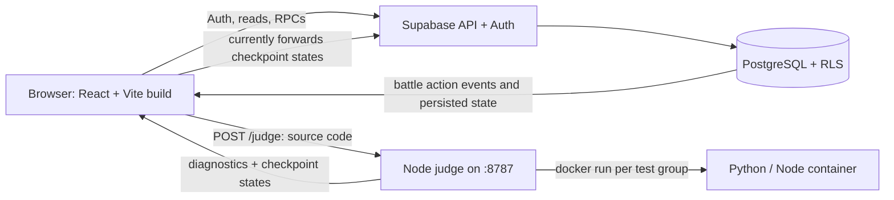

# 1. Architecture and technical concepts

Zenpho combines a single-page application (SPA), a local code judge, Docker, and a Supabase/PostgreSQL backend. These are distinct processes with distinct trust levels. Understanding that separation is the key to rebuilding the project correctly.

The browser is an interface and therefore untrusted. It displays questions and animations, collects code, calls APIs, and plays back returned events. The judge executes that code and compares it with test cases that are **not** bundled into the frontend. PostgreSQL stores ownership, HP, inventory, energy, battle attempts, catches, and rewards. The current combat turn function calculates damage and enemy actions in the database. A remaining security gap is that the browser forwards judge checkpoint results to a separate database RPC; see [the battle chapter](05-judge-and-battle.md#critical-trust-boundary).

## Why each technology is present

| Technology | Job in this repository | Key idea to learn |
| --- | --- | --- |
| **TypeScript + React 19** | Typed components, hooks, battle/editor screens | Render UI from state; update state through events instead of editing the DOM directly. |
| **Vite 8** | Dev server, asset pipeline, production bundle | `import.meta.env.VITE_*` is injected into browser code at build/dev time; it is never a secret store. |
| **React Router** | URL-to-page mapping and guarded routes | `/battle?question=...` is a client route; the host must serve the SPA entry for refreshes. |
| **TanStack Query** | Fetch/cache of server state | Query keys identify data; after RPC mutations, invalidate affected keys to refetch. |
| **Zustand** | Session and battle playback state | Use it for immediate cross-component state, not as the authoritative ledger for rewards. |
| **Monaco Editor** | Python/JavaScript source editing | The editor's text is submitted as data to the judge; the browser never runs Python. |
| **Tailwind CSS + CSS files** | Layout, pixel UI, responsive styling | Utility classes coexist with the custom battle and gate styles. |
| **Framer Motion / canvas** | UI transitions and game presentation | Animation timing and sprites must not decide persistent outcomes. |
| **Supabase Auth + PostgREST** | Identity, session, table reads, SQL RPC calls | A signed-in user gets a JWT; database RLS and function checks still decide access. |
| **PostgreSQL** | Game state and transactionally updated rules | Constraints, locks, and functions protect multi-step writes from races. |
| **Node HTTP + Docker** | Isolated code checks | One HTTP judge process launches one short-lived container per checkpoint group. |

## Three kinds of state

1. **Persistent authoritative state:** Supabase rows for creatures, party, HP, resources, attempts, inventory, Pokédex, and rewards. Read via adapters in `frontend/src/lib/`; write through validated RPCs.
2. **Cached server state:** TanStack Query hooks in `frontend/src/hooks/`. These cache rows to keep screens responsive. Invalidation after a purchase, catch, or battle asks the server for the new truth.
3. **Ephemeral presentation state:** React `useState` and Zustand's `battleStore` hold open dialogs, editor text, animations, pending events, and status banners. Losing this state must not create or erase authoritative rewards. `battle_attempts.code_draft` stores submitted drafts, but unsent editor edits are not a guaranteed durable save.

## A complete player journey

1. `Signup.tsx` calls Supabase Auth. The `auth.users` trigger creates a profile, resources, and starter inventory. If email confirmation is enabled, an unconfirmed account has no valid session and cannot select a starter.
2. The authenticated player chooses Bulbasaur, Charmander, or Squirtle through `choose_starter`. The database creates the creature and first party slot.
3. Practice loads active questions. Each question maps to one Pokémon. The browser opens `/battle?question=<id>` and loads its public statement and starter code.
4. Run sends sample tests to the judge. Submit sends sample, hidden, and large-input groups. Python code must define `solve(...)`; JavaScript code must export `solve(...)`. The judge returns results and diagnostics.
5. A first successful solve is recorded in `battle_attempts` and earns one energy. A repeated solve may open another encounter but does not repeat the solve reward.
6. Entering the fight spends one energy through `spend_battle_energy`. The party may use moves, switch creatures, or use healing items. `take_battle_action` updates HP and returns ordered events for playback.
7. A victory can award first-win coins/XP and permit a catch attempt. The database checks species ownership, ball inventory, and latest win before performing the catch.

## Request and deployment boundaries

- **Vite port:** usually 5173 in development. It serves the browser app, not the judge.
- **Judge port:** 8787 by default. `npm run judge` starts the Node listener. Docker containers exist only while a Run/Submit request is executing; `--rm` removes them afterward.
- **Supabase:** either a hosted project URL or a separately started local stack. Docker Desktop showing `supabase_db`/`supabase_auth` means the local Supabase CLI stack is running; those containers are unrelated to the judge.
- **Another device:** its browser must reach the Vite host, judge host/port, and configured Supabase URL. The default judge URL is the **website hostname** on port 8787. If the website is served from machine A, starting a judge on viewing machine B does not serve that browser request.

These concepts follow the repository's implementation. For general background, see the official [React state guide](https://react.dev/learn/managing-state), [Vite environment guide](https://vite.dev/guide/env-and-mode.html), [Supabase RLS guide](https://supabase.com/docs/guides/database/postgres/row-level-security), and [Docker run reference](https://docs.docker.com/reference/cli/docker/container/run).
