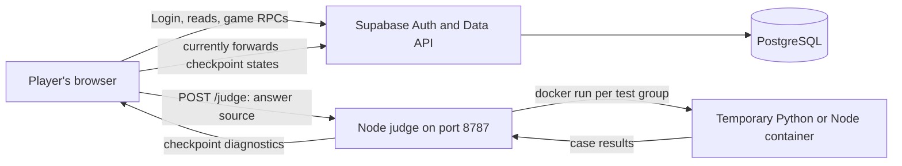

# Backend concepts: the services that check and save the game

This guide explains Zenpho's **backend** to a beginner. The backend is the trusted side of the application: Supabase Auth, PostgreSQL tables/functions, and the separate Node/Docker code judge. It saves player progress, checks whether actions are allowed, and returns outcomes. The [frontend guide](FRONTEND.md) explains how the browser displays those outcomes.

The physical folder name can be misleading: the Node judge lives in `frontend/scripts/judge-server.mjs`, but it runs as a **server process** and is backend code. Its private cases live in the root `judge-data/` folder. Database code lives in `supabase/migrations/`.

## 1. One game, two backend services

The **database backend** handles accounts and saved game rules. The **judge backend** runs submitted code against cases. They are separate because running arbitrary player code is a different and riskier job than storing account data. The current browser-mediated handoff between them is a known security gap, covered [below](#the-current-trust-boundary).

## 2. Backend vocabulary

| Term | Plain meaning | Zenpho example |
| --- | --- | --- |
| **Server** | A program that waits for requests from another program. | The Node judge waits on port 8787. |
| **HTTP** | Rules for sending web requests and responses. | The browser sends `POST /judge`. |
| **Endpoint** | A specific request address and method. | `/judge` accepts submitted code. |
| **JSON** | Text format for structured values. | A result has `tests`, `diagnostics`, and `solved` fields. |
| **API** | A set of allowed requests between programs. | Supabase's Data API exposes reads and RPC calls. |
| **Authentication (Auth)** | Proving which account is making a request. | Supabase issues a session after sign-in. |
| **Authorization** | Deciding what that account may do. | RLS lets a player read only their own creatures. |
| **Database** | Long-lived organized storage. | PostgreSQL keeps HP, coins, energy, party, and attempts. |
| **SQL** | Language for defining/querying/changing database data. | `UPDATE player_resources SET energy = energy - 1`. |
| **Docker image** | A template for a container. | `python:3.12-alpine` is the Python runner image. |
| **Container** | A short-lived process environment made from an image. | One test group runs in one temporary container. |

An HTTP error such as “judge unreachable” means the browser could not contact the judge. A wrong answer means the judge ran the solution and found a mismatch. Those are different failures and must be shown differently.

## 3. How the judge receives an answer

[frontend/src/lib/judge.ts](../frontend/src/lib/judge.ts) sends a JSON request to [judge-server.mjs](../frontend/scripts/judge-server.mjs). It includes question ID, language, mode, and source code. The judge validates a known question ID, accepts only Python or JavaScript, accepts only `run` or `submit`, limits the source length, and looks up cases from [judge-data/question-tests.json](../judge-data/question-tests.json) **on the server**. The client never supplies expected answers.

| Mode | What the judge runs | What it means |
| --- | --- | --- |
| `run` | Sample test group only | Quick feedback; it does not solve the question. |
| `submit` | Sample, hidden, then large-input/efficiency groups | All must pass for a successful submission. The judge stops on the first failed group. |

A test case has an `input` object and an `expected` value. The public question contains the function starter, examples, and constraints; hidden and large-input cases stay outside `frontend/src/` and `frontend/public/`. Those frontend paths could be delivered to a player. **Efficiency** here means the large-input cases complete under a time limit; the judge does not prove or measure Big-O complexity.

The language runners load a submitted `solve(...)` function and call it for each case. Python requires a complete `def solve(...):` definition and valid indentation; JavaScript requires an exported `solve`. A correct algorithm pasted as an incomplete function body can fail before any case is evaluated.

## 4. Why Docker is used and what its limits mean

The judge creates a temporary folder containing the solution, runner, and one test group. It starts `docker run` with a read-only workspace mount, no network inside the container, 256 MiB memory, one CPU, and a per-group timeout. Python uses `python:3.12-alpine`; JavaScript uses `node:22-alpine`. The container is removed with `--rm`; the temporary host folder is removed afterward. An empty Docker Desktop container list between submissions is normal.

The flags reduce ordinary risk and make execution repeatable, but they are not a complete hostile-code sandbox. The current judge endpoint is unauthenticated and allows cross-origin requests. It should not be exposed as a public code-execution service without authentication, rate limits, stronger host isolation, monitoring, and a trusted result handoff. A container uses the host's Docker engine; Docker being installed is not by itself an authorization system.

Run `npm run judge` from `frontend/` to start the Node service. Run `npm run judge:check` in another terminal to submit a known-good Python Two Sum solution through HTTP and Docker. This proves the actual execution path. If Docker cannot start, the judge should report an infrastructure error, not call the player's answer wrong.

## 5. PostgreSQL building blocks

Think of a **table** as a structured spreadsheet, a **row** as one record, and a **column** as one field. A **primary key** uniquely identifies a row. A **foreign key** links a row to another table. A **constraint** rejects invalid values. An **index** helps a lookup find rows faster and can enforce uniqueness.

For example, `player_resources.user_id` is the primary key, so one player gets one resource row. `coins >= 0` is a constraint, so even a mistaken update cannot save negative coins. `player_creatures.user_id` links an owned Pokémon instance to its trainer. `party_slots` selects up to six owned creature IDs; it is not a second copy of each creature.

Other concepts used in the migrations:

| Concept | Why it matters here |
| --- | --- |
| **Enum** | Limits a value to named choices such as battle status or question difficulty. |
| **JSONB** | Stores structured event/prompt data in PostgreSQL where a fixed column per subfield is unnecessary. |
| **UUID** | Unique identifier for a user, creature, or attempt. |
| **Trigger** | Runs database code automatically after a related event; the signup trigger creates player rows after an Auth user is inserted. |
| **Function / RPC** | Named operation that validates and changes several rows together, exposed to the frontend through Supabase. |
| **Transaction** | All changes in one operation succeed or all roll back. A purchase must not remove coins without adding the item. |
| **Row/advisory lock** | Serializes competing requests so two fast clicks cannot both claim one reward. |
| **Migration** | Numbered SQL file that evolves schema or functions in a repeatable order. |

The [database guide](04-database-and-auth.md) maps all tables. The [file atlas](from-scratch/file-atlas.md#database-configuration-tests-and-migrations) describes every migration and its purpose.

## 6. Authentication versus authorization

Supabase Auth handles signup, confirmation, sign-in, and session tokens. A signed-in browser sends a session with API calls. In database functions, `auth.uid()` returns the authenticated user's ID. **Authentication** answers “who are you?” **Authorization** answers “may you read or change this row?”

The initial migration's `auth.users` trigger provisions a profile, starting resources, and inventory when an account is created. If email confirmation is enabled, signup can create a user but return no active session; that player cannot yet choose a starter. The frontend should wait for confirmation and sign-in rather than treating the signup response as authenticated.

The browser uses a **public/anon key** with its Supabase URL. That key is expected to be visible. A database password or service-role key is powerful and must never be placed in a `VITE_` variable, frontend source, or screenshot. Public keys do not make a table public by themselves: grants, row-level security, and function checks still decide access.

## 7. RLS, grants, and private functions

**Row-level security (RLS)** is a PostgreSQL rule that filters which rows a role can read or modify. A typical player policy compares the row's `user_id` with `auth.uid()`. Catalogs such as active questions and species may have public read policies; personal resources and creatures have owner-only policies. A **grant** permits an operation at the table/function level, while RLS restricts qualifying rows. Both are needed.

The frontend does not directly write coins or HP. It calls functions such as `buy_item`, `spend_battle_energy`, or `take_battle_action`. Many are `SECURITY DEFINER` functions, which can run with elevated database privileges. Such a function must verify `auth.uid()`, check ownership and input values, set a restricted search path, and grant execute only to intended roles. Internal helpers and move data live in `app_private` rather than being client-editable tables.

Do not trust a `user_id` supplied by a browser, or editable user metadata, to authorize a purchase or reward. The database should derive identity from the verified session.

## 8. The important saved tables

| Table | What it stores |
| --- | --- |
| `profiles` | Public-facing trainer name tied to an Auth user. |
| `player_resources` | Coins, XP, energy, and maximum energy. |
| `pokemon_species`, `questions`, `inventory_items` | Public catalogs for species, active problems, and shop items. |
| `player_creatures` | Owned creature instances, level, XP, and persistent `current_hp`/`max_hp`. |
| `party_slots` | Up to six selected owned creatures. |
| `player_inventory` | Quantity of each owned item. |
| `battle_attempts` | Question/species/language, draft, checkpoint states, fight state, and outcome. |
| `battle_events` | Ordered records of attempts and turns. |
| `player_pokedex`, `catch_attempts` | Seen/caught status and catch attempts. |
| Milestone/gym tables | Goals, progress, and claimed rewards. |

This is why a refresh or another device can show the same saved party and HP. React state alone would disappear or disagree across devices.

## 9. The game rules enforced by functions

1. **Starter:** `choose_starter` permits the approved starter IDs, rejects a second choice, creates the creature, and places it in the party.
2. **Attempt:** `start_battle` checks the active question and matching encounter species, then creates a `battle_attempts` row.
3. **Solve:** `record_battle_result` saves draft and checkpoint states. A first passing solve grants one energy; duplicate solves can create rematches without repeating first-solve rewards.
4. **Entry:** `spend_battle_energy` requires a passing attempt, one available energy, and a healthy selected party member. It subtracts one energy once for that attempt. Moves do not spend energy.
5. **Turn:** `take_battle_action` validates move, switch, or item; computes hit/damage and enemy response; persists creature HP and attempt state; returns ordered events for the UI.
6. **Outcome:** When one Pokémon faints, a healthy party member can replace it. The fight is lost when the available party collapses. A first confirmed win can award coins/XP.
7. **Catch:** `catch_pokemon` checks a latest matching win, valid ball and stock, and species ownership. It decides the roll and consumes a ball. A won rematch may catch a species still unowned; an already owned species cannot be caught again.
8. **Shop and goals:** `buy_item` checks that the item is active and the player has enough coins, then adds one item atomically; milestone/gym claim functions enforce eligibility and prevent repeat claims.

The SQL calculates combat and stored account mutations. The browser receives an event list and plays it back. There are no speed bonuses or battle countdown timers. “Large-input efficiency” is a test-group outcome, not a claim about Big-O.

## 10. Migrations and safe changes

`supabase/migrations/` contains timestamped SQL files. Apply them in filename order. Later `CREATE OR REPLACE FUNCTION` definitions replace earlier versions of the same signature, so an early migration is not necessarily the current rule. The latest persistent battle function is in `20261020160000_persistent_party_battles.sql`, followed by a type-lookup correction in `20261020161000_fix_battle_type_lookup.sql`.

The repo's `frontend/scripts/apply-supabase-migrations.mjs` helper uses `SUPABASE_DB_URL` and records filenames in `public.schema_migrations`. The Supabase CLI uses a different migration-history table. Do not mix both methods on the same database without reconciling histories. Never commit a connection URI or put it in frontend `.env.local`. Apply a new migration on a disposable database before a shared project; do not silently edit an already applied migration.

## The current trust boundary

The current judge returns pass/fail checkpoint states to the **browser**, and the browser sends those states to `record_battle_result`. The database validates the attempt and computes rewards, but it cannot independently prove that the judge actually passed the submitted code. A modified client could lie about a solve. The judge also lacks account authentication. A public version needs a trusted backend-to-database result handoff or a verifiable judge attestation tied to user, attempt, question, code hash, and expiry, plus judge authentication, rate limiting, and stronger execution isolation.

The intended small HP cost for wrong submissions is not implemented by the current `record_battle_result` function. It saves the failed state and draft, but does not deduct persistent HP. Distinguishing intended rules from implemented rules matters when explaining or extending the project.

## 12. Running and checking the backend

For a local demo, choose hosted or local Supabase using [the setup guide](02-local-setup.md). Apply all migrations. On the computer hosting the website, ensure Docker Desktop is running, pull the Python and Node images, and start `npm run judge` from `frontend/`. The Vite frontend is a different process. `npm run judge:check` proves an actual Python submission can pass through HTTP and Docker; `node --test scripts/judge-server.test.mjs` checks the judge's infrastructure-error behavior. The database SQL test file lives at `supabase/tests/backend_game_systems_rls.test.sql` and should run against disposable local data.

For a second device, its browser must reach the website, judge port 8787, and Supabase URL. `localhost` on that device points to that device, not the development computer. See [multi-device troubleshooting](07-verification-deployment-and-troubleshooting.md) for the full checklist.

### Quick self-check

If a player changes a button in browser developer tools, could they make the database award coins? The answer should be no; SQL functions must validate the underlying action. In the current project, combat outcomes meet that principle, but the solve proof sent from the judge through the browser does not yet. That is the most important backend boundary to understand.
