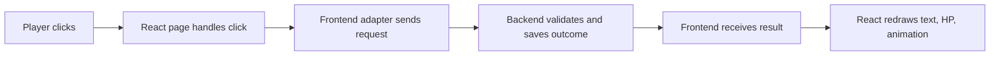

# Frontend concepts: the part the player sees

This guide explains Zenpho's **frontend** from the beginning. You can read it without knowing web development. The frontend is the code running in the player's browser: pages, forms, the code editor, the battle display, sounds, and buttons. It can **request** a move or a catch, but the saved result must come from the backend. Read [BACKEND.md](BACKEND.md) for the judge, database, and rules that persist account state.

If you want to build along while reading, start the [beginner build course](from-scratch/README.md). Its [file atlas](from-scratch/file-atlas.md) explains each source file, and its [copyable source](from-scratch/copyable/README.md) contains the exact text files.

## 1. The frontend's job

Imagine a player presses **Fight**. The button is frontend. Showing a loading gate and Pokémon sprite is frontend. The `spend_battle_energy` database call decides whether the player has energy and subtracts one. The frontend then shows the returned balance. If the browser simply subtracted one from a number on screen, a refresh would restore the old number and another device would disagree.



The browser is controlled by the player. Its code and requests can be changed with developer tools. This is why it should display coins, XP, HP, energy, and catches returned by the backend rather than decide those outcomes itself.

## 2. The basic web words

| Term | Meaning in plain language | Zenpho example |
| --- | --- | --- |
| **HTML** | The structure of a page. | `frontend/index.html` contains the root element where React starts. |
| **CSS** | Rules for how things look and fit on a screen. | `frontend/src/index.css` and `battle-polish.css` define colors, sizes, and gate motion. |
| **JavaScript** | Code that reacts to clicks and communicates with services. | Clicking Submit calls the judge. |
| **TypeScript** | JavaScript with checks for expected data shapes. | A battle action is typed as `move`, `switch`, or `item`. |
| **TSX / JSX** | TypeScript that can describe UI using tags like `<button>`. | `Battle.tsx` renders the editor and arena. |
| **Node.js** | A way to run JavaScript outside the browser. | npm/Vite tooling uses Node; the separate judge server also uses Node. |
| **npm** | Installs packages and runs scripts from `package.json`. | `npm run dev` starts Vite from `frontend/`. |
| **Vite** | Development server and production builder. | Serves the app while developing; `npm run build` creates `frontend/dist/`. |
| **Package** | Reusable code installed by npm. | React, React Router, Monaco, and TanStack Query are packages. |
| **Single-page app (SPA)** | One HTML shell; JavaScript switches visible pages. | `/hub` and `/battle` are routes within the same React app. |
| **API request** | A message sent to another service. | `POST /judge` sends source code to the judge. |

TypeScript helps catch mistakes while building; it does **not** make a browser request trustworthy. A `number` type does not prevent a player from changing an HTTP body.

## 3. Where the frontend files live

The active app is in `frontend/`. The root `package.json` belongs to an older scaffold and is not the game runtime. The key folders are:

| Path | Why it exists |
| --- | --- |
| `frontend/src/pages/` | Whole screens such as Login, Hub, Practice, Battle, Shop, and Collection. |
| `frontend/src/components/` | Pieces reused across screens: header, button, HP bar, modal, battle stage, loading gate. |
| `frontend/src/hooks/` | Reusable React functions that fetch and cache server data. |
| `frontend/src/lib/` | Adapters that know API/RPC names, question mapping, audio, and sprite loading. |
| `frontend/src/store/` | Shared, immediate browser state such as auth session and event playback. |
| `frontend/src/data/` | Public question and Pokémon display catalogs bundled with the app. |
| `frontend/public/` | Files the browser can download directly: sprites, animation data, sounds, and icons. |
| `frontend/scripts/` | Node tools, including the **backend** judge. Folder location does not make these browser code. |

Files under `src/` can be bundled into the browser. Files under `public/` can be fetched by URL. Neither place is safe for a database password, service-role key, or hidden tests. Those belong on trusted services.

## 4. How the app starts

Open [index.html](../frontend/index.html). Its `<div id="root"></div>` is an empty mount point. [main.tsx](../frontend/src/main.tsx) finds that element, imports fonts/CSS, and renders `<App />`. [App.tsx](../frontend/src/App.tsx) adds the shared systems and chooses a page from the URL.

The providers in `App.tsx` have distinct jobs:

1. **`QueryClientProvider`** makes TanStack Query's server-data cache available to pages.
2. **`AuthBootstrap`** restores an existing Supabase session and listens for login/logout changes.
3. **`BrowserRouter`** reads the URL and enables navigation.
4. **`AudioSceneController`** chooses music for the current screen.
5. **`LoadingGate`** closes the visual gates before a route changes and opens them afterward.

`AppRoutes` maps URLs to pages. Page imports use React `lazy(...)`, so a visitor does not download the large Battle/Monaco code before entering Battle. `Suspense` shows a fallback while a lazy page loads. `ProtectedRoute` requires a real session for private pages; a signup response that says a user was created but has no session is not a login.

## 5. React components, props, state, and hooks

A **component** is a function that describes part of the UI. A **prop** is an input supplied by its parent. **State** is a value the component remembers and can change. When state or props change, React runs the component again and updates the screen.

```tsx
function EnergyLabel({ energy }: { energy: number }) {
  return <span>Energy: {energy}</span>
}
```

Here `EnergyLabel` is a component, `energy` is its prop, and `{energy}` places the number into the displayed text. This snippet only **shows** energy; it does not spend or earn it.

React **hooks** are functions beginning with `use`. `useState` remembers a local value, `useEffect` runs work when the component mounts or dependencies change, and project hooks such as [usePlayerParty.ts](../frontend/src/hooks/usePlayerParty.ts) fetch server data. Hooks belong inside React components or other hooks, not in arbitrary condition branches.

For example, `usePlayerParty` uses a query key containing the user ID. That prevents one account's cached party from being reused as another account's party. Its `enabled` setting waits until a user exists, and `staleTime` allows a short cache before the next fetch.

## 6. Three kinds of frontend state

| Kind | Where it lives | Example | What happens on reload? |
| --- | --- | --- | --- |
| **Local component state** | `useState` in a page | Open Results panel, selected language, current editor text | Usually resets; only an explicitly saved draft persists. |
| **Shared browser state** | Zustand store | Auth session view, queued battle animation events, audio preference | May reset or restore from browser storage, depending on the store. |
| **Cached server state** | TanStack Query | Coins, party, solved questions, collection | Refetched from Supabase; PostgreSQL remains the source of truth. |

After an action changes saved data, pages invalidate the relevant query keys. For example, [Battle.tsx](../frontend/src/pages/Battle.tsx) invalidates `player-party` after a turn so the next read gets persisted HP. An animation can show the returned event immediately, but the cache must still be refreshed. Avoid manually inventing a new account balance in React state.

## 7. Routes and pages

React Router connects a URL to a page component. `/practice` lists questions. `/battle?question=easy-arrays-two-sum` opens a particular question; the portion after `?` is a **query parameter**. It helps choose what to display, but the backend validates the actual question/encounter when an attempt is created.

| Screen | Main purpose |
| --- | --- |
| Landing / Signup / Login / AuthCallback | Entry, account creation, sign-in, email confirmation. |
| Starter | One-time first Pokémon choice, requested through an RPC. |
| Hub | Main navigation, resources, party, and progress. |
| Practice | Search/filter public questions and show solved state. |
| Battle | Prompt, Monaco editor, Run/Submit results, Fight prompt, event-driven arena, catch. |
| Collection | Seen/caught Pokémon, party selection, recovery items. |
| Shop / Gyms / Leaderboard / Profile | Items, topic goals, public rankings, and account summary. |

The [file atlas](from-scratch/file-atlas.md#page-files) links every page and describes its responsibilities.

## 8. How frontend code talks to services

The [Supabase client](../frontend/src/lib/supabase.ts) is created from `VITE_SUPABASE_URL` and `VITE_SUPABASE_ANON_KEY`. `VITE_` values are visible in the browser, so only public configuration belongs there. A signed-in Supabase session identifies the player; database RLS and function checks decide which rows and actions are allowed.

The `lib/` files keep network details out of page markup. For example, [battleAttempts.ts](../frontend/src/lib/battleAttempts.ts) calls `supabase.rpc('take_battle_action', ...)`; [party.ts](../frontend/src/lib/party.ts) reads selected creatures; [collection.ts](../frontend/src/lib/collection.ts) calls `catch_pokemon`. A page calls the adapter and handles loading, success, and errors.

The [judge client](../frontend/src/lib/judge.ts) sends code to the separate HTTP judge on port 8787 by default. It returns group states and diagnostics. The browser shows sample errors and runtime errors in Results. The current browser forwards the judge's checkpoint states to a database RPC; see [the backend trust boundary](BACKEND.md#the-current-trust-boundary) before treating that as a secure production design.

## 9. Monaco and the coding workspace

**Monaco** is the editor component. It provides a typing surface and language support; it does not judge code. In [Battle.tsx](../frontend/src/pages/Battle.tsx), Run sends only sample tests; Submit asks for sample, hidden, and large-input checkpoints. The Results panel displays pass/fail states and errors. A syntax error or Docker outage must be visible without deleting the player's code.

`react-resizable-panels` lets a player give more space to the prompt, editor, or Results. The frontend must keep those panels usable at laptop and phone widths. A resizable panel is a layout feature; it has no relationship to the score or saved progress.

## 10. Battle animation and sound

The database returns an **ordered event list**: examples include `player_attack`, `enemy_hp`, `switch_in`, and `victory`. [battleStore.ts](../frontend/src/store/battleStore.ts) plays one event at a time, updating dialogue and displayed HP. [BattleStage.tsx](../frontend/src/components/ui/BattleStage.tsx) draws the arena. [pokerogueAnimation.ts](../frontend/src/lib/pokerogueAnimation.ts) uses a 320×180 logical canvas and frame data for visual effects. The canvas can be scaled to fit the screen without changing the database's HP calculation.

[LoadingGate.tsx](../frontend/src/components/ui/LoadingGate.tsx) uses phases such as closing and opening to hide route swaps. Audio is opt-in through [audio.ts](../frontend/src/lib/audio.ts); mute and volume are presentation preferences. Missing sound should not prevent a battle result from being shown. Media in `frontend/public/pokerogue/` has different sources and terms; read its [attribution](../frontend/public/pokerogue/ATTRIBUTION.md) before redistributing assets.

## 11. Styling, responsive design, and accessibility

**Tailwind CSS** provides utility classes inside components. The CSS files add shared theme and detailed battle styles. A **responsive** layout changes arrangement as the viewport narrows; it should keep buttons, code, Results, and combatants visible. Check a narrow phone, tablet, and laptop. `prefers-reduced-motion` allows players who request less animation to pass through transitions faster.

**Accessibility** means the UI works beyond one mouse-and-sound setup. Use real buttons, readable labels, keyboard focus, status text for important results, and error messages that do not rely on color alone. An HP bar should have a textual value; a win should have readable text even if the victory animation or audio fails.

## 12. A beginner's way to change a frontend feature

1. Find its page in `frontend/src/pages/` and read what it displays.
2. Find its hook in `frontend/src/hooks/` and adapter in `frontend/src/lib/` to learn where data comes from.
3. Decide whether the new value is temporary UI state or saved backend state. If saved, define/adjust the backend contract first.
4. Handle loading, empty, success, and error states. Keep the draft and explain errors when a request fails.
5. Check keyboard use, a narrow screen, and a reload. If the change affects server data, verify another account does not see it.
6. From `frontend/`, run `npm run lint` and `npm run build`. The build checks code, but it cannot prove the judge or database is reachable.

### Quick self-check

If a player closes the page, should the value still exist? If yes, it probably belongs in PostgreSQL. If it is only whether a modal is open, it belongs in React. If it is fetched from PostgreSQL but temporarily cached, TanStack Query manages that copy. That one distinction explains much of the frontend design.
