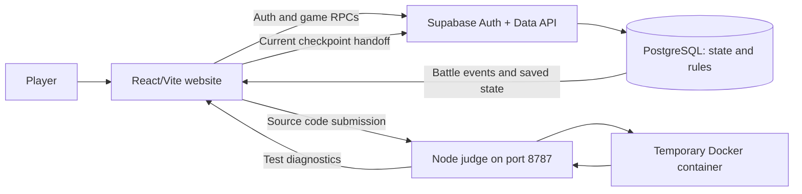

# Zenpho: context brief for a presentation creator

Use this file as a handoff for creating a PowerPoint presentation about Zenpho. It describes the project as found in this repository on **29 October 2026**. The intended audience can be a college project review, demo, or technical introduction. Keep the story understandable to people who have not seen the code. For implementation detail, use [FRONTEND.md](FRONTEND.md), [BACKEND.md](BACKEND.md), and the [developer guide](README.md).

## One-paragraph project summary

**Zenpho is a Pokémon-style coding practice game.** A player creates an account, chooses a starter Pokémon, solves a programming question in an in-browser editor, and can spend one energy to battle the Pokémon associated with that question. The game includes a party of up to six, persistent HP, switching, items and revives, catches, a Pokédex/collection, shop, gyms, milestones, profile, and leaderboard. There are **50 public coding questions with 50 distinct encounter Pokémon**, and the public display roster has **151 species**. Python and JavaScript submissions are tested by a separate Node judge using temporary Docker containers. Supabase Auth and PostgreSQL save player data and calculate combat, inventory changes, and rewards.

## The problem and intended value

Traditional coding practice often gives only a pass/fail result. Zenpho makes each solved problem an encounter and ties continued progress to questions. The aim is to make repeated practice more engaging through collection, battles, visible progress, and feedback. This is the project's design objective, **not a measured claim** that it improves learning outcomes or retention. Do not invent user counts, adoption metrics, benchmark results, or educational impact data.

## What a player does: the story to show in slides

```text
Sign up / confirm email / log in
             ↓
Choose Bulbasaur, Charmander, or Squirtle
             ↓
Browse Practice and select one coding question
             ↓
Write Python or JavaScript in the Monaco editor
             ↓
Run samples; Submit sample + hidden + large-input tests
             ↓
On a pass, receive one energy on the first solve
             ↓
Choose Fight or return to Hub
             ↓
Spend one energy to enter the battle
             ↓
Use a move, switch party member, or use an item
             ↓
Win, try a catch, and inspect Collection / Hub / Profile
```

One coding problem corresponds to one battle encounter; its sample, hidden, and large-input groups are checkpoints of that problem. The large-input group checks whether cases finish within a time limit; it does **not** formally measure Big-O complexity. There are no battle countdowns or speed bonuses. Solved progress and submitted drafts are saved. A repeat solve may lead to another fight but does not grant the first-solve or first-win reward again. If that Pokémon species is not yet owned, a won rematch may offer another catch chance; an already owned species cannot be caught again.

## Main working features

| Area | What is implemented |
| --- | --- |
| Account | Supabase signup/login, optional email confirmation, protected routes, one-time starter selection. |
| Coding practice | Question search/filter, examples, constraints, Python/JavaScript starter functions, Monaco editor, resizable coding/results panels. |
| Judge feedback | Run sample tests; Submit sample, hidden, and large-input groups; show pass/fail, runtime errors, and infrastructure errors in Results. |
| Energy and combat | First solve earns one energy; entering a fight spends one; moves do not cost energy. PostgreSQL calculates turns, HP, fainting, switching, and party collapse. |
| Progression | Up to six selected party members, persistent creature HP, healing/revive items, catches, collection/Pokédex, coins, XP, shop, gyms, milestones, leaderboard, profile. |
| Presentation | Gate opening/closing transitions, Pokémon sprite/arena assets, move animations, switching effects, optional cries/music/sound effects. |
| Multiple devices | Account and game state live in Supabase; the viewing device must also reach the website and judge service. |

Avoid describing these as a complete replica of PokéRogue's engine. Zenpho adapts selected visual and audio resources and implements its own React/canvas presentation with PostgreSQL game logic.

## Architecture: who does what



**Frontend:** React 19, TypeScript, Vite 8, Tailwind CSS, React Router, Zustand, TanStack Query, Monaco, Framer Motion, resizable panels, and canvas animation. It displays questions and event playback, sends requests, and manages local interaction.

**Backend:** Supabase Auth, PostgreSQL tables/RLS/functions, and a separate Node HTTP judge with Docker. PostgreSQL persists ownership, coins, energy, party, HP, attempts, items, catches, and rewards. The judge reads hidden tests from `judge-data/` and runs Python/JavaScript code in short-lived containers. The frontend build alone does not start the judge or database.

**Trust boundary:** The browser is not authoritative for saved game values. PostgreSQL functions compute combat and stored rewards. However, the browser currently forwards judge checkpoint pass/fail states to `record_battle_result`, and the judge endpoint is unauthenticated. A public, adversarial deployment needs a trusted result handoff and judge hardening. This is a genuine current limitation; do not claim the entire solve/reward path is tamper-proof.

## Important game rules and examples

- **Energy:** The database starts accounts with configured resources; each first successful question solve adds one energy. Starting one fight spends one energy. Moves and switches do not spend energy.
- **Party:** At most six owned creatures can be selected. HP is stored on each creature, so a fainted Pokémon stays fainted across reloads until an item restores it. A fight can continue after one member faints if another selected member is healthy.
- **Rewards:** A first qualifying win gives coins/XP according to question difficulty. Duplicate solves/rematches are allowed for play and a possible uncaught-species catch, but cannot farm first rewards.
- **Catches:** The database checks a matching win, ball inventory, and species ownership, then performs the catch roll and records the result. Catch animation follows that result.
- **Submission errors:** Wrong answers and code/runtime errors should appear in the Results area without erasing the draft. A Docker/network problem is an infrastructure error, not a wrong answer.
- **Current product-rule gap:** The intended small HP penalty for a wrong submission is **not yet implemented** in the current `record_battle_result` function. Do not present it as a working feature.

## Why these technologies were chosen

| Technology | Plain-language role in the project |
| --- | --- |
| React + TypeScript | Build pages from reusable components and catch shape/type mistakes while developing. |
| Vite | Fast development server and production frontend build. |
| React Router | Move between Login, Hub, Practice, Battle, Shop, and other URLs. |
| Zustand | Manage immediate shared UI/session and battle event playback state. |
| TanStack Query | Fetch and refresh saved backend data after a battle, purchase, or catch. |
| Monaco | Provide a code-writing experience in the browser. |
| Tailwind CSS + Framer Motion + canvas | Style responsive pages and animate gates, sprites, and move effects. |
| Supabase Auth + PostgreSQL | Identify players and store long-lived game state with database policies and functions. |
| Node HTTP judge + Docker | Keep test cases server-side and run submitted code in a controlled temporary environment. |

## Repository map for a technical slide

| Path | Meaning |
| --- | --- |
| `frontend/src/pages/`, `components/` | Screens and reusable visual pieces. |
| `frontend/src/hooks/`, `lib/`, `store/` | Data fetching, service adapters, and immediate browser state. |
| `frontend/src/data/questions.json` | Public catalog of 50 questions and encounters. |
| `frontend/public/pokerogue/` | Local media and attribution. |
| `frontend/scripts/judge-server.mjs` | Backend judge process despite its folder name. |
| `judge-data/question-tests.json` | Private judge cases, outside the served frontend. |
| `supabase/migrations/` | Ordered schema, catalogs, RLS, and game-rule SQL functions. |
| `supabase/tests/` | Database behavior/security test SQL. |
| `docs/` | Developer guides and this presentation handoff. |

## Suggested slide narrative

This is a suggestion, not a required deck template. A 10–12 slide project presentation can use:

1. **Title:** Zenpho — coding practice as a Pokémon-style adventure.
2. **Problem and goal:** Ordinary pass/fail practice versus an encounter-driven practice loop; state the goal without fabricated impact statistics.
3. **Player journey:** Signup → starter → question → submit → fight → catch/progress.
4. **Coding experience:** Question prompt, examples, Monaco editor, Run/Submit and visible diagnostics.
5. **Judge design:** Public prompt versus private cases; Node service and temporary Docker containers; three checkpoint groups.
6. **Battle design:** One energy per fight, six-member party, persistent HP, server-computed turn events.
7. **Progression:** Shop, Revive, collection, Pokédex, gyms, milestones, profile, leaderboard, duplicate reward guard.
8. **Frontend architecture:** React pages, shared UI, Query cache, Zustand playback, responsive/audio/animation.
9. **Backend architecture:** Supabase Auth, PostgreSQL/RLS/functions, judge, trust boundaries.
10. **Demo or screenshots:** Show an actual successful submission and battle transition; include Results errors if useful.
11. **Testing and limits:** Build/lint, `judge:check`, database tests; explain current unauthenticated judge/browser-supplied checkpoint gap and wrong-answer HP gap.
12. **Next steps:** Trusted judge attestation, service hardening, tests/deployment improvements, optional further content.

For slide visuals, use screenshots of the actual app when available. Suitable moments: Hub resources/party, Practice catalog, editor + Results, success Fight/Hub overlay, battle arena with HP bars, Collection/Shop. Label an image as a mockup if it is not a real screenshot. A simple architecture diagram is more useful than a crowded code screenshot. Keep code excerpts short and include what they prove.

## Demo and verification facts

From `frontend/`, `npm run build` type-checks/bundles the website, `npm run lint` runs Oxlint, `npm run judge` starts the local judge, and `npm run judge:check` sends a known-good Python Two Sum solution through HTTP and Docker. The judge starts containers only during a submission and removes them afterward. For a demo on another device, Vite must listen on the network, the host must allow port 8787, and both devices must reach the configured Supabase API. The [verification guide](07-verification-deployment-and-troubleshooting.md) contains the full walkthrough. Do not claim tests were run on the day the presentation is made unless you actually rerun them.

## Media and attribution for presentation use

Zenpho uses selected PokéRogue-derived sprites, battle animation data, sounds, and music. The project keeps [asset attribution](../frontend/public/pokerogue/ATTRIBUTION.md), [REUSE metadata](../frontend/public/pokerogue/REUSE.toml), and upstream license notices. These assets have **different** origins and legal terms. Pokémon and source project names belong to their respective owners; Zenpho is an unaffiliated college project. A slide deck should credit PokéRogue/Pagefault Games for adapted resources and avoid implying that all assets share one open-source license or that Zenpho is officially associated with Pokémon.

## Facts to preserve; claims to avoid

**Safe verified facts from the repository:** 50 question records, 50 unique encounter species, a 151-species display roster, Python and JavaScript judge paths, six party slots, one energy spent on fight entry, persistent creature HP, server-side combat turns, and Docker containers removed after testing.

**Do not claim without new evidence:** production readiness, a secure public code-execution service, a 1:1 copy of the full PokéRogue game engine, measured Big-O analysis, measured learning gains, active user counts, complete asset ownership, or that wrong submissions currently deduct HP. The current security boundary should be stated honestly if the deck discusses safety or deployment.
